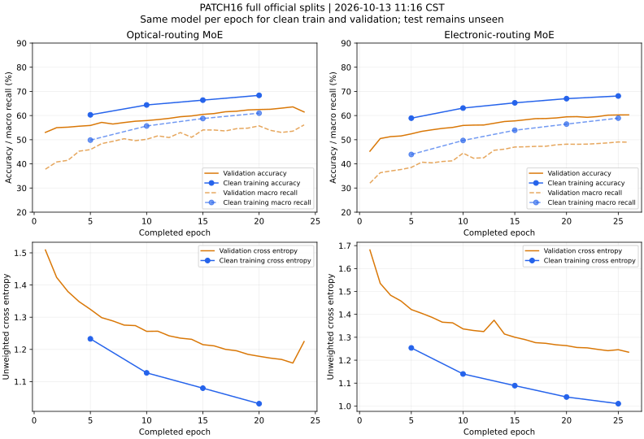

# PATCH16 首轮训练监督：2026-10-13 11:16 北京时间

仅包含训练/验证证据，测试尚未评估。原始全量 Train/Validation/Test 为
88,971/12,354/28,039，官方病例划分及16类保持不变。本轮负责 T17，
不改变运行中的光路、数据、类别或其它任务；最多两个项目 GPU 进程。

## 实际状态

run 为 `runs/simulation/patch16_four_top2_s17_20261013`。
光/电训练分别完成24/26轮，D2NN在现有CPU监督队列，尚未开始。
光路由在 UUID `4d8bfdb9`，电路由在 `3f60d773`。
运行源码为 `9f0e6e312`；后续文档提交或其它任务改变 main HEAD 不代表本轮训练代码改变。
快照来自各组已经写出的完整逐轮 metrics，不将单独 selected_validation.json
写入中的下一轮与旧status拼接。每轮均已验证完整88971训练记录和12354验证记录。

| 模型 | 已完成轮数 | 当前获选轮数/权重 | 获选完整验证准确率 | 获选验证宏召回 | 最近清洁训练诊断：轮数、准确率、验证准确率、差距 |
|---|---:|---|---:|---:|---|
| 光MoE | 24 | 20 / EMA | 62.49% | 55.73% | E20：68.36% / 62.49%，5.87百分点 |
| 电MoE | 26 | 25 / EMA | 60.25% | 49.06% | E25：68.10% / 60.25%，7.85百分点 |
| 普通D2NN | 0 | 排队 | — | — | 某条MoE结束且物理卡空闲后由原监督进程接续 |

获选指标是准确率与宏召回的均值，59.11%或54.65%的selection score
不能称为准确率。同一轮清洁训练和验证均使用同一个online/EMA模型；
训练时有增强/加权/辅助项的train_loss不是此表交叉熵。
跨轮绘图展示每轮获选online/EMA，并不是反复评估最后一个best。

## 已发现的问题及处理依据

1. **尚无明显的验证持续恶化，尚未收敛。**光验证交叉熵 E5/E20 为1.3245/1.1787，
   准确率55.89%/62.49%；电 E5/E25 为1.4210/1.2458，
   准确率52.42%/60.25%。无增强训练准确率也仍在提升，但只有约68%，
   不能把不足80%直接归因为过拟合。电组训练验证差距从6.50到7.85百分点，
   需要继续关注泛化差距；暂不盲目加大正则。
2. **光路由塌缩是当前重点。**获选E20验证的四专家平均功率为
   3.64%/0.91%/95.45%/0.00%，全部样本的最大权重均是专家3。
   实际Top-2配对为(1,3)78.30%、(2,3)21.70%，有效专家数1.23。
   Top-2严格执行并不代表两个专家功率相近，第四专家未被选中。
   电组E25平均功率8.96%/21.67%/32.20%/37.18%，有效专家3.60；
   这是全验证集平均，不要求每张样本四专家全部启用。
3. **小类召回偏低、验证宏召回敏感。**光E20 nerves召回1.83%、hair follicle 9.20%；
   电E25分别3.65%/6.40%。elastosis原验证仅6条，
   单条正确性变化可改变宏召回约1.04百分点、复合选模约0.52百分点。
   必须结合准确率、交叉熵和逐类召回趋势判断平台；不删类别、不改官方划分。

## 定期跟进与后续动作

用户已授权本聊天每20分钟检查，旧暂停的本聊天heartbeat已更新为
“PATCH16 三组训练与泛化跟进”；没有新建工作树、分支或独立工程。
每次核对实际PID/UUID、run身份、日志推进和GPU释放；状态无实质变化不重复通知。
每轮完整验证、每5轮完整无增强训练诊断，不占第三张GPU。

- 保持当前首轮训练；最低60、最高120轮，达到最低预算且连续15轮无至少0.2百分点
  选模改善时可结束。若到上限准确率/交叉熵还明显改善，明确记为预算不足，
  再制定有限续训；不能自动称“120轮已收敛”。
- 训练继续改善而验证恶化时，保留此前验证best并检查读出/路由正则和学习率；
  两者均低且仍改善时，先检查优化/收敛，不一味加正则。
- 若光路由塌缩持续且性能改善受阻，候选优先调整训练期路由均衡损失，
  必要时分阶段学习率；保留原run/best/last，不改四专家、Top-2、OEO或光路。
  是否改善仍只看完整验证，不强制按类别指定专家或制造均匀结果。
- D2NN按既定普通训练由队列运行，不人为削弱，不以满足预期趋势作选择。
  三组首轮预计仍需约2–5小时（随实际D2NN吞吐及早停更新），路由优化候选另计。
- 所有参数/预算选择只依据验证。最终选定checkpoint后评完整清洁训练/验证和测试一次，
  保存训练测试差距；已有result不重测，不按测试分数追加训练。

当前远未达到两种MoE均超过80%、较D2NN高5百分点的目标，也没有新的测试成绩。
后续的重要异常、修改原因、候选成本和失败均追加记录，不用旧CRC结果替代PATCH16。

原始监督快照：[snapshot_1116.json](snapshot_1116.json)；
可编辑曲线：[training_validation_1116.svg](training_validation_1116.svg)。

## 11:38 监督补记（仍在训练，不读取测试）

实时核对监督进程 PID 2068883、光 MoE PID 2068891（物理 GPU UUID
`4d8bfdb9`）及电 MoE PID 2068892（UUID `3f60d773`）均在运行；
`suite_status.json` 仍将 D2NN 排队，本项目仅占两张 GPU。服务器主目录当前 HEAD
`9172b11e`，不作为正在运行模型源码 `9f0e6e312` 的替代身份。

光 MoE 已完成 E36，当前验证获选 E32 EMA：准确率 65.14%、宏召回 56.78%、
交叉熵 1.1174，复合选模分数 60.96%。E35 同权重类型的完整无增强训练／验证
准确率 71.43%／65.17%，差 6.26 百分点；训练／验证交叉熵分别
0.9535／1.1156。相比 E20，两边准确率与交叉熵仍改善，不能宣布整体收敛或
典型过拟合；但验证宏召回 E32 56.78% 到 E35 54.04% 的短期回落须继续观察。
E32 验证平均路由功率 2.84%／1.17%／95.98%／0%，全部样本最大权重均为
专家 3，专家 4 未启用，有效专家数 1.21；较 E20 未改善。

电 MoE 已完成 E40，最新验证获选 E40 EMA：准确率 62.47%、宏召回 55.59%、
交叉熵 1.1910，复合选模分数 59.03%。E40 完整无增强训练准确率 70.58%、
宏召回 63.84%，与验证准确率差 8.11 百分点；交叉熵和验证准确率仍改善，
暂不因差距独立停止。获选验证平均路由功率 8.78%／19.23%／33.68%／38.31%，
较光路由分散。两组尚未达到最低 60 轮预算，D2NN 尚未训练，三组测试均未评价。
继续按完整验证及每 5 轮清洁训练诊断观察；若光路由塌缩持续且验证改善受阻，
再从保留原 run 的前提下设计训练期均衡／学习率候选，不修改正在运行的源码或权重。

## 11:56 监督补记（验证选模波动）

核对 `suite_status.json`、真实 PID 命令及 `nvidia-smi` 物理 UUID：原监督进程和
两条 MoE 训练仍运行，D2NN 未开始，本项目保持两张 GPU、没有测试评价。
光 MoE 已完成 E46，按原复合验证指标获选 E45 EMA：验证准确率 65.86%、
宏召回 58.09%、交叉熵 1.0913，选模分数 61.97%；E45 相同 EMA 的清洁训练
准确率 72.58%、宏召回 66.40%、交叉熵 0.9236，与验证准确率相差
6.72 百分点。验证准确率/交叉熵仍改善，不能宣称已收敛；路由平均功率为
2.80%／1.06%／96.15%／0%，有效专家数 1.20，全部样本仍首选专家 3，
专家 4 未启用。

电 MoE 已完成 E51，获选权重仍为 E40 EMA（验证准确率 62.47%、宏召回
55.59%、交叉熵 1.1910，选模分数 59.03%）。E50 当前 EMA 验证准确率
63.38%、交叉熵 1.1715，均较 E40 改善，宏召回却为 54.62%；E50 清洁训练
准确率 71.88%、验证准确率 63.38%，差 8.50 百分点。验证 elastosis
仅 6 条，E40 6/6 正确而 E50 4/6，仅此类的召回变化就令十六类宏平均下降约
2.08 百分点，足以掩盖其它类别的合计改善。继续沿用事先规定的准确率与宏召回
均值选模，不因小类波动临时改选择口径；同时报告交叉熵、逐类召回和趋势。
两组尚未满最低 60 轮，当前不重启、不追加候选，也不读取测试集。

## 12:35 监督补记（均已超过最低轮数）

监督进程与两条 MoE 训练的 PID、命令及物理 GPU UUID 均与原记录一致；D2NN
仍在原队列，本项目只占两张卡，三组测试均未运行。光 MoE 已完成 E69，
按预设复合验证指标仍获选 E58 EMA：准确率 66.73%、宏召回 58.09%、
交叉熵 1.0692，选模分数 62.41%。E65 同为 EMA 的完整无增强训练准确率
74.11%、验证准确率 66.93%，差 7.17 百分点；训练／验证交叉熵分别
0.8801／1.0677。自 E58 至 E69 尚不足预设的 15 轮平台观察窗，且验证
准确率、交叉熵仍有改善，不能仅因超过 60 轮停止或断言过拟合。
但获选 E58 的路由平均功率为 2.87%／0.95%／96.18%／0%，有效专家数
1.20，所有验证样本首选专家 3，专家 4 完全未使用；塌缩持续存在。

电 MoE 已完成 E77，E76 EMA 获选：验证准确率 65.00%、宏召回 57.48%、
交叉熵 1.1403，选模分数 61.24%；E75 同为 EMA 的完整无增强训练／验证
准确率 74.38%／65.05%，差 9.33 百分点。E76 刚刷新验证选模分数，
因此不满足平台停止条件。获选路由平均功率约为
9.39%／17.28%／34.25%／39.07%，有效专家数 3.52。两种 MoE 的训练
准确率均仍提高，验证也有缓慢改善，但差距扩大；继续按相同 checkpoint
和权重类型观察，不能把分数不足目标直接归为单一原因。保留原 run，
若光路由塌缩伴随验证平台达到 15 轮门槛，再比较有依据的训练期均衡候选。

## 12:55 阶段事件：光 MoE 原 run 验证平台结束

`suite_status.json` 显示光 MoE 正常退出（exit code 0），完成 E73，停止原因是
在最低 60 轮预算后，连续 15 轮未出现至少 0.2 百分点的验证复合选模分数提升。
获选 E58 EMA，完整验证准确率 66.73%、宏召回 58.08%、交叉熵 1.0692、
选模分数 62.41%；E73 最新验证准确率虽为 67.06%，但宏召回 57.70%，
按预先规定的复合指标不能替换 E58。E70 相同 EMA 的完整无增强训练／验证
准确率为 74.34%／67.06%，差 7.28 百分点；交叉熵 0.8724／1.0629。
训练仍有改善，但验证复合指标平台；这提示泛化和路由利用均需排查，
不能将已停止称为达到 80% 目标或把训练预算误当成收敛证明。

获选 E58 的验证路由平均功率 2.87%／0.95%／96.18%／0%，有效专家数
1.20；专家 3 是每条验证样本的首选，专家 4 从未进入 Top-2。
原 best/last 和配置须保留。此 run 没有 `result.json`，测试次数仍为零；
在仅用验证集确定后续优化是否有价值之前，不对它进行正式测试。
监督队列在同一物理 GPU UUID `4d8bfdb9` 自动启动 D2NN PID 2138603，
使用普通 `standard` recipe；电 MoE PID 2068892 继续占 UUID `3f60d773`。
本项目仍只占两张 GPU，没有重复启动或抢占其它项目。D2NN E11 时验证
准确率 56.51%、宏召回 40.77%，仍处早期，不能作为最终对照。

电 MoE E89 时原获选 E76 EMA：验证准确率 65.00%、宏召回 57.48%、
交叉熵 1.1403、选模分数 61.24%。E85 同权重类型清洁训练／验证准确率
74.87%／64.81%，差 10.05 百分点；训练交叉熵 0.8483、验证 1.1371。
E76 后尚未满预设 15 轮平台窗，仍交由原监督进程继续；不得根据光 MoE
的停止情况人为削弱或终止电 MoE。

## 13:15 阶段事件：电 MoE 原 run 验证平台结束

`suite_status.json` 显示电 MoE 在 E91 正常退出（exit code 0），原 PID
2068892 已从 GPU 进程列表消失；停止原因为最低预算后的 15 轮观察窗内
没有至少 0.2 百分点的验证选模分数提升。E91 online 虽是获选最高分
61.26%，只比 E76 EMA 的 61.24% 高约 0.02 百分点，低于平台重置阈值。
E91 完整验证准确率 64.47%、宏召回 58.04%、交叉熵 1.1515；
E76 EMA 的验证准确率 65.00%、宏召回 57.48%、交叉熵 1.1403，
两种权重类型须如实区分，不将一方的最高准确率和另一方的最高宏召回拼接。
E90 online 的完整无增强训练／验证准确率 73.30%／64.68%，差
8.62 百分点，交叉熵 0.9093／1.1467；训练仍有改善，验证复合指标进入
平台，但不能单凭差距认定所有类别均过拟合。

获选 E91 验证路由平均功率约 9.92%／17.96%／33.07%／39.05%，
有效专家数 3.56，较光 MoE 分散。两种 MoE 均未达到 80% 验证准确率，
均没有 `result.json`、没有测试评价。D2NN 已由原监督队列在释放的物理
GPU UUID `4d8bfdb9` 上训练，E28 时获选 E26，完整验证准确率
59.55%、宏召回 48.41%；这仍是早期结果。当前本项目仅占一张 GPU，
其余 GPU 上的非本项目进程保持不动。后续训练候选须仅依据验证集设计，
保留两条原 run 的 best/last、配置与停止记录，不改光路合同或 D2NN 普通训练。

## 14:35 三组首轮验证完成与光路由候选

原监督队列的普通 D2NN 在 E70 按预设验证平台规则结束，获选 E55 online：
完整验证准确率 65.14%、宏召回 60.90%、交叉熵 1.0957。
E70 的无增强完整训练／验证准确率为 73.03%／64.29%，差 8.73 百分点；
交叉熵为 0.8216／1.1632，但 E70 不是获选 checkpoint，不能与 E55 的
验证数拼成一组训练／验证结果。至此三组首轮均已正常退出，三组测试数均为零，
本项目自有 GPU 均已释放。D2NN 验证成绩不支持“光 MoE 比 D2NN 高 5 个
百分点”的目标；不修改正常训练的 D2NN 以制造差距。

为了排查光 MoE 的长期塌缩，从原 E58 EMA best 建立独立验证候选
`patch16_optical_balance01_s17_20261013`，源码 main `1496c181c`。它保持
PATCH16 全量训练、相同固定输入、全部光路参数、严格 Top-2、两次 OEO 和
唯一 Linear(784,16)，只将训练期 dense-KL 路由均衡系数 0.01 提为 0.1，
相位／读出头学习率降至 0.001／0.0002。完成 E14 后按验证平台停止，获选
E4 online：准确率 66.36%、宏召回 60.44%、复合选模分数 63.40%，相比原
E58 的 66.73%／58.08%／62.41%，宏召回和复合分数改善，但普通准确率
下降 0.37 百分点。专家平均路由功率仍为 2.98%／1.22%／95.80%／0%，
专家 4 仍从未进入 Top-2，有效专家数仅由 1.20 增至 1.22。
故该候选不能证明路由塌缩已解决，也没有进行测试。

为避免盲目加权，仅在原 E58 checkpoint 的 32 条验证样本上检查可训练信号：
Top-2 前的 CCD 归一化平均功率约为 5.00%／2.21%／91.89%／0.89%，
第四端口并非绝对无光，但从未进入 Top-2。该批普通交叉熵对 router_phase
的梯度范数约 0.199，原 dense-KL 均衡项未加权梯度范数约 0.00929；
系数 0.1 后仅约 0.000929，不到交叉熵梯度的 0.5%。这为原小权重未改变
路由提供了梯度尺度证据，不等于证明单一批次代表全体样本。

据此从同一原 E58 checkpoint 启动第二条独立验证候选
`patch16_optical_balance1_s17_20261013`（PID 2220569，物理 GPU UUID
`3f60d773`），仅把 dense-KL 系数升到 1.0；其余训练及推理合同与上一候选
相同，最多 20 轮，仍只用验证集比较并记录精度与路由的取舍。不覆盖原run，
不测试失败候选。其它项目的 GPU 进程一律不触碰。

## 14:55 强均衡候选失败，暂不测试

`patch16_optical_balance1_s17_20261013` 完成 E10 并按预设候选预算平台规则退出，
获选 E1 EMA 完整验证准确率 64.02%、宏召回 57.05%、交叉熵 1.1829、
复合选模分数 60.54%，低于原光MoE 62.41%及0.1系数候选 63.40%。
均衡系数从0.1再提高到1.0后，专家3的平均功率仍有92.01%，专家4仍未进入
Top-2；有效专家数1.39。这个结果说明直接提高该均衡项的代价已超过收益，
并未解决当前路由塌缩。该候选保留best/last和验证记录，不测试、不作为最终模型。
候选 PID2220569 已退出，原监督进程及D2NN也已结束，本项目GPU均已释放。

下一步的训练方法候选应明确分开“让路由端口可用”和“分类联合优化”：仅用
PATCH16训练划分做短暂、无标签的路由相位预热以提高四端口的稠密CCD功率覆盖，
然后保持相同光学前向、严格Top-2及唯一Linear进行联合分类训练。预热只优化
已有router相位，不增加推理参数或替换几何；必须保留预热前后完整验证精度和
逐端口功率，若分类性能无改善则不测试。不得以验证样本更新相位。

## 15:09 用户禁止A100，保留候选并迁移续训

每20分钟的检查实际有执行，11:38、11:56、12:35、12:55、13:15、14:35、
14:55已有上方监督和优化记录，但阶段结果未清楚集中展示，用户反馈进度不透明。
本次任务README补齐三组首轮验证表，并将本聊天监控改为每次检查后给一条短进度。

仅router相位预热3轮后，完整验证四专家功率22.73%/29.25%/20.91%/27.12%，
有效专家3.96；同时准确率降至9.25%、宏召回6.99%、CE35.2383。
这是已有专家/读出与新路由不匹配的证据，不能把均衡本身当作成功。
联合分类E3已恢复验证65.19%/54.47%，但功率又集中93.96%到专家3；
还未超过原光MoE，测试仍为0。

用户15:09要求禁用A100，实时核对PID2241159的模块、run、cwd、进程组、
CUDA UUID及nvidia-smi中的实际A100型号后，仅SIGTERM该T17进程组。
已确认GPU进程列表中该PID消失，自有GPU释放；best/last及预热checkpoint保留。
run内保存`interruption_no_a100_20261013.json`，最后已提交checkpoint为联合E4。
不干扰其它GPU进程。所有后续PATCH16训练/评估/调度均加入非A100入口检查，
必须提供经nvidia-smi核验的完整GPU UUID，拒绝所有A100和数字卡号。

恢复入口为同一候选的`--resume`：核对配置/原数据/父checkpoint/完成历史，
恢复raw、EMA、AdamW状态并逐张量比较；不重跑3轮预热，不重跑E1–E4，
保留原cosine进度和停止钟，联合总预算仍20轮。旧checkpoint缺少RNG状态，
首次迁移显式记录重设随机种子、不能声称逐bit延续；新last开始保存RNG。
与模型图、任务定义、训练损失及测试选择均无关系的硬件政策不改变架构比较。

15:18实际迁移启动PID2259897，物理GPU5 RTX3090/UUID `d53ce4c8`，运行源码
`560605523`。15:19读取run内resume事件，raw/EMA/AdamW逐张量比较通过，
明确接续E5，未重复预热或完成轮次；旧last SHA为
`6a8d88bdc2d6774ada791a8f4a9cbd50af9424fd563ca22e71b0c8ddd9be6999`。
A100实际显存17MiB、GPU进程列表无T17；唯一T17 GPU进程在3090约1322MiB。
config的A100 UUID仅是初始段身份，后续实际卡必须看resume事件、/proc及nvidia-smi。
服务器40项测试通过；恢复时尚未完成E5，不把“恢复成功”误当作新验证成绩。

## 16:10 非A100续训结果

同一预热候选从E4断点在RTX3090上继续至联合E10，依照既定验证平台规则停止，
没有重新预热或重复已完成轮次。获选E10 EMA的完整验证准确率66.43%、
宏召回55.58%、交叉熵1.1111；原光MoE获选E58 EMA对应为66.73%、
58.08%。四专家平均路由功率为3.47%/1.54%/94.04%/0.95%，有效专家数1.33，
专家3仍为全部验证样本的最大功率端口。因此预热虽暂时分散了功率，联合训练
并未维持这种分布，也未改善选模成绩。该候选保留best/last、恢复事件和失败记录，
测试次数为0；T17进程已退出，非A100卡显存回落至空闲水平。

下一轮若继续探索，应将路由分散与分类适配分成可验证的有限阶段：从保留的
预热checkpoint出发，短暂冻结router，仅让原有专家、全局相位和单层读出头
适应新的Top-2分配，再低学习率联合更新。每阶段检查完整验证准确率、宏召回、
交叉熵、逐类召回和路由；若未优于原光MoE，不测试，也不因目标尚未达到而
无限延长训练。该方案目前仅是待验证候选，未作为结果报告。

候选预算预设为12轮分类训练：前4轮固定预热后的router相位，仅更新同一
四专家、全局相位与单层Linear；后8轮恢复原有严格Top-2全参数联合训练。
直接复用已保存的3轮预热checkpoint，不重复预热；其来源SHA须与原光MoE
E58 checkpoint和PATCH16划分一致。其余增强、类别权重、EMA、学习率
（相位0.001、电子读出0.0002）、dense-KL系数0.1与上一候选相同，
以便单独检验冻结适配阶段的作用。每轮完整验证，至少8轮、8轮无显著
选模提升即停；只有验证综合分数超过原光MoE且逐类表现可接受，才考虑一次
测试。该候选使用独立run和非A100 GPU，不覆盖任何历史结果。

## 21:25 用户要求的严格训练精度与收敛复核

重新加载三组首轮best，对每组完整无增强Train88971/Val12354评估，
不加载Test，不反向、不改权重，实际使用空闲RTX3090/UUID `d53ce4c8`。
每组约50–52秒，验证accuracy/macro逐数与原选模收据一致，
checkpoint评估前后SHA未改变。核验任务结束，GPU进程退出。
[完整原始核验收据与SHA](best_trainval_audit_2125.json)。

| 模型与获选权重 | Train accuracy | Val accuracy | gap | Train macro | Val macro | Train CE | Val CE |
|---|---:|---:|---:|---:|---:|---:|---:|
| 光MoE E58 EMA | 73.59% | 66.73% | 6.86pp | 67.93% | 58.08% | 0.8952 | 1.0692 |
| 电MoE E91 online | 73.50% | 64.47% | 9.03pp | 69.14% | 58.04% | 0.8685 | 1.1515 |
| D2NN E55 online | 73.24% | 65.14% | 8.09pp | 69.51% | 60.90% | 0.8567 | 1.0957 |

原来的最后一次5轮周期诊断不一定正好对应best，这张表不使用插值或混用epoch。
三组训练精度均低于80%；既有泛化差距，也有训练拟合/有效容量不足，
无法只归因为过拟合，更没有证据保证继续原设置到120轮会达到目标。

收敛判断依据全部末段曲线而不是completed状态：

- 原光MoE E59–73，前5/后5验证准确率均值66.57%/66.98%，
  CE1.0717/1.0639；仍有慢速改善。复合accuracy/macro因小类波动未刷新，
  触发既定早停，仅代表验证选模平台。路由有效专家1.20、专家3占96.18%为结构利用异常。
- 原电MoE E77–91，前5/后5验证准确率64.90%/64.91%，
  CE1.14242/1.14252，确实接近验证平台。EMA E75–85训练74.38%→74.87%，
  验证65.05%→64.81%，有过拟合倾向；不得与E90/91 online状态混成同一趋势。
- 原D2NN E56–70，验证accuracy58.66%–64.63%，CE1.1210–1.3715；
  前5/后5均值63.03%/62.25%，CE1.1997/1.2313。训练CE从E55的0.8567
  降到E70的0.8216而验证变差，是泛化退化及优化波动，不能宣称稳定收敛。
  固定学习率可能是因素，尚未通过对照证明；保留既定E55 best，不选更差末轮作基线。
- 最新冻结适配候选E12：训练68.08%/验证62.26%，macro54.35%/49.19%；
  E8→12验证+1.08pp、CE1.2784→1.2469。最后轮即最高分，12轮结束是预算边界，
  **不是收敛或方法无效的充分证据**。需有限延长以判断上升是否继续；
  同时其专家3占84.51%功率，路由集中仍存在。

后续优先延长仍有上升证据的有限候选，结合路由、相位优化、损失/正则尺度诊断；
不盲目全部补轮数，不用测试集作继续训练的依据。当前没有新的测试准确率。
