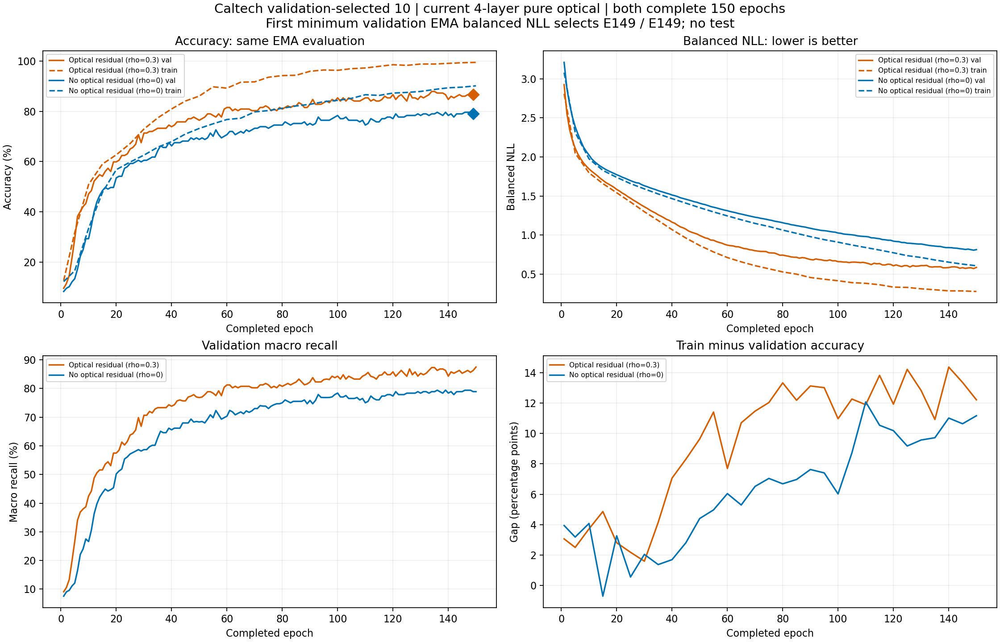

# 新Caltech十类：完整同150轮与独立科学最终结果

双方完整150轮、maximum_epochs、无early；CPU campaign2220246/queue2220984与GPU4残差2221711/GPU2对照2229841实际全退出，两生产子原始exit_code0。rootstate caltech10_gap_complete_science_passed，active0/pending0/fail0/test0，GPU2/4/5项目0/A1000。自己的独占科学第一次passed、audit/completed SHA实际一致。

| 指标 | 有光学残差rho.3 | 无光学残差rho0 |
|---|---:|---:|
| 实际轮数 | 150 | 150 |
| firstminimum选中轮次 | 149 | 149 |
| 训练准确率 | 99.3430% | 90.2760% |
| 验证准确率 | 86.6242% | 78.9809% |
| 验证macro | 86.3258% | 78.9135% |
| 验证balancedNLL | 0.5708938839 | 0.8056351399 |
| 训练-验证差 | 12.7188pp | 11.2951pp |
| 拟合秒 | 748.58633 | 742.57277 |

验证正确136/157对124/157，净多12正确，残差领先7.6433个百分点；macro领先7.4123pp。两臂均真实跑完150，按首次最低验证EMA balancedNLL均选E149，选149不是提前停止。自身验证86.6242%已超过80，保有7.6433pp单seed同预算优势；不是测试80、原20或完整Caltech101达到80，也没有跨seed稳定性证明。

## 类别筛选范围与真实性

用户明确允许必要时筛类以兼顾准确率和差距。原Caltech101压缩档存在，历史经过原角色/数量限制得到47候选、原train-only缩略图centroid验证代理再固定20。代理不等于当前光学模型成绩；本次避免无限搜索，只从真实当前四层原20的E100验证逐类结果一次选10：有残差recall>=60%、残差差值>=0，按recall+.5*gain降序、同分字母序，取10后字母序固定。未使用test做本次筛选；此前Caltech测试已观察，未来重叠测试不能叫完全未见。

固定名单：Faces、Leopards、Motorbikes、airplanes、bonsai、grand_piano、revolver、schooner、trilobite、yin_yang；原20indices[0,1,2,3,4,7,14,15,16,19]。新train761/val157/test1833仅metadata、原角色ID/划分和原坐标窗口保持。验证知情开发任务；小验证集、类别选择偏差须保留，不以挑旧行平均冒充这次新训练成绩。

## 真实曲线与诊断

train只画实际评估E1/每5轮，val每轮，同EMA balancedNLL，无平滑/造点/补点。训练99.34/验证86.62仍相差12.72pp，对照90.28/78.98差11.30pp；拟合与泛化并非都已解决。相比原20降低了类别混淆、两组都变容易，不把全部准确率提高归因残差。采用完整同150轮配对，没削弱对照、没用最大accuracy/gap换选模。当前结果支持此十类开发候选，不证明可通过继续加轮确保测试80。

[全部真实逐轮指标](epoch_metrics.csv)、[逐类训练/验证CSV](class_recall.csv)、[SVG](training_curves.svg)。PNG实际视觉QA后交付。

| 类别 | 验证张数 | 有残差recall | 无残差recall | 差pp |
|---|---:|---:|---:|---:|
| Faces | 20 | 90.00% | 80.00% | +10.00 |
| Leopards | 20 | 75.00% | 70.00% | +5.00 |
| Motorbikes | 20 | 100.00% | 95.00% | +5.00 |
| airplanes | 20 | 90.00% | 80.00% | +10.00 |
| bonsai | 19 | 84.21% | 68.42% | +15.79 |
| grand_piano | 14 | 85.71% | 85.71% | +0.00 |
| revolver | 12 | 58.33% | 58.33% | +0.00 |
| schooner | 10 | 80.00% | 70.00% | +10.00 |
| trilobite | 12 | 100.00% | 91.67% | +8.33 |
| yin_yang | 10 | 100.00% | 90.00% | +10.00 |

## 来源、预算与科学

run `caltech10_gap_s17_current4_pair150_gpu425_20261015`，169训练来源`259cdcfdec6edc9b8ca29f9c7ddf18fb3668cffa`（不是旧RESISC169），current/original来源逐项真核一致。全908552phase/四224专家/E-G-E-G四主层+光router/478global/RGB100/8bit/10原窗口，无可训练电子分类支路；双方freshseed17同初值、同order/affineMix/MixUp.2/LS.08/TV.05/capture.2/EMA.95/lr.002和scheduler，各150*48=7200Adam、尾9、effective16/micro8。各3600fit秒上限内，无early、未扩预算/重试。GPU4先训练残差，GPU2原20释放后训练无残差，启动时间不同、实际预算匹配；与原20合计从未超过三张非A100一卡一子。

独占science SHA `617825b1c2d628b7a2cefdd13874d4c4ca3e468ed16338def5561b3d723051db`，actual_audit_returncode0/completed真匹配。独立核new169source/config/PT/rawEMA/init/shape/11grad/7200Adam/150orderaffineMix/LR/安全秒预算/保存IDlabelargmax10CMsupportmacroNLL/逐轮CM/firstminimum，CPU2models仅shape/seed、0forward/test。无failure，不手动重审。metadataSHA3227d5c1fbd86a2454b1df51d8b58e2ca772bfbe32c26733650d15a06b463f71；CPU nativeSHA75af8c42cda5497163b255a8d13e17bab41f8aea2ca9fa29c293fc46f41acec3、GPU4numericSHAff5cd2de2b26c6cd283569814d5cb85f951db97f926b2bac90cf371622397747已一次passed，不重做。

残差selectedPT `8f7037445a77defbec297e5d24f8abfb639a89565e7992216976314a971c6815`，history `2db7ed346978b4c40079a9b00167ee47d48c655a09709d2f44b58fd0cc94d154`。
对照selectedPT `95886e6af086bafb2915baf050cf37e2e3241f4ec503f1d539b5f09d069970ea`，history `cbfbc98f59a7a70b02d6a794f06a3ed458dbd42550711c7aa6ae136a87ea0513`。

本次两个有界方案均全完成；原20同200为68.1979/62.8975、差5.3004pp，新十类同150为86.6242/78.9809、差7.6433pp，各自报告，不拼跨任务对照。当前新训练授权结束，不自动第二次筛类/重训/调参/扩预算/test/电子支路/A100/额外深度/native/formal6/lab。全部source/PT/data/history/claims保护，rawJSON/IDs/完整日志/PT私有。t18与09晨报ACTIVE保留，完成结果本turn一次报告、后续正常完成静默。
