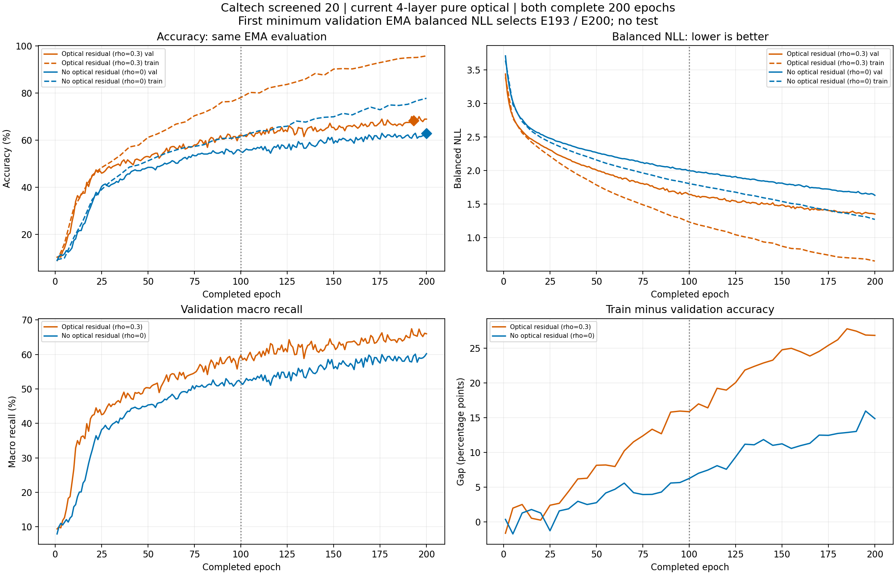

# 原Caltech筛选20类：同200轮接续最终结果

双方完整200轮、maximum_epochs、无early，CPU campaign/queue及两GPU子实际退出，producer原始exit_code0。自己的独占科学第一次passed，audit/completed SHA一致，无test、无额外候选。

| 指标 | 有光学残差 | 无光学残差 |
|---|---:|---:|
| 实际轮数 | 200 | 200 |
| firstminimum选中轮次 | 193 | 200 |
| 训练准确率 | 94.5335% | 77.7697% |
| 验证准确率 | 68.1979% | 62.8975% |
| 验证macro | 65.7161% | 60.2210% |
| 验证balancedNLL | 1.3500847289 | 1.6314205855 |
| 训练-验证差 | 26.3356pp | 14.8722pp |
| 本次新增拟合秒 | 835.67214 | 864.35617 |

同200轮验证差+5.3004个百分点，macro差+5.4951pp。原同100轮62.1908/55.1237、差7.0671pp；现在双方提高，但对照追得更快，差距缩小。残差训练94.53/验证68.20，泛化差26.34pp，继续训练并未解决过拟合。原20未80，不宣称充分收敛、稳定因果或测试成绩。新十类是另一个开发任务，不能替代原20验收。

完整恢复父E100 raw/EMA/Adam8600/scheduler100/LR.002，保留前100历史、不重播/重置。共同再训练100轮，最终各17200Adam；MixUp.2/LS.08/TV.05/capture.2/EMA.95/原scheduler不变，没有手动额外LR减半。单seed17，原20名单/划分/current4/908552phase/8bit不变，无可训练电子分类器。首次最低验证EMA balancedNLL选E193/E200，选193不代表提前停止；两组E200已完成。

曲线取保存history：train只在实际评估轮次，val每轮，无造点/平滑；同EMA balancedNLL，竖线100标接续起点，菱形标原firstminimum选中点。[逐轮聚合CSV](epoch_metrics.csv)、[所有类别训练/验证召回](class_recall.csv)、[SVG](training_curves.svg)。PNG已实际视觉QA后交付。

run `caltech20_current4_s17_pair_continue200_gpu25_20261015`，160训练来源`c266b7973b105be6caa0dcdb95cfe2fe7cba2abc`，current/original真实逐项核一致（包含额外独立审核助手，不是旧155漏记）。科学SHA`3d381ac398a03e8b7a4ede3476049c238cbc4ed12148deff8874e9ddec28525d`，actual_audit_returncode0，独立核prefix100/恢复态/config/source/PT/11grad/17200Adam/orderaffineMix/LR/新增安全预算/保存IDlabelargmaxCMsupportmacroNLL/firstminimum；CPU2model只shape/seed，0forward/test。

残差selectedPT `b1ded62070b87338a3ebd52413105561294b040381c9a4f89748740d1705a4ff`、history `3486ddcdc374f671091e8605b79824a32668e53b2292a8bd02f91eabc3b2ac27`。
对照selectedPT `c349874ead2c4a4686494c0365a3b5d737e8354e97be9ec9d7c10609e950c189`、history `0f346aca02add07fb8770393122836506f095cd4ac0a5de05f084061ff4d615f`。

每组3600新增fit秒上限内完成，不再加轮/重审/重试；全部源码/PT/数据/history/claims保护。新十类150配对仍按已批准合同推进，最多3张非A100，不自动test。rawJSON/完整日志/逐样本ID/PT私有，Git仅本聚合报告/图/CSV。
