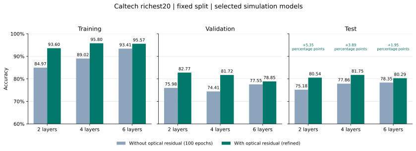
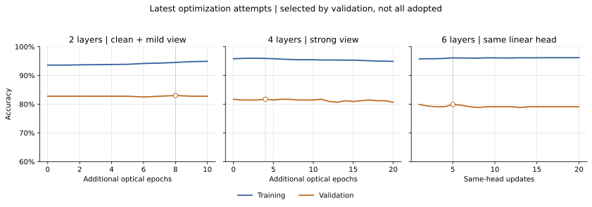

# Caltech20 current residual-gap refinement review

This is the richest20 development task: TRAIN3141/VAL383/TEST411, unchanged in this round. Router occurs once; E-G repeats1/2/3 times. Original six arms were each trained100 epochs; no-residual controls have remained frozen. Same learned-alpha>.7 electronic residuals and5140-parameter terminal linear are used during training and inference.

|Depth|Residual optical/head budget; selected|Residual TRAIN/VAL/TEST %|Frozen control TRAIN/VAL/TEST %|TEST gap pp|
|---|---|---|---|---|
|2|100 optical / 40 head; parentE86, head27, tune0|93.6008/82.7676/80.5353|84.9729/75.9791/75.1825|+5.3528|
|4|100 optical / 20 head; parentE86, head4, tune0|95.7975/81.7232/81.7518|89.0162/74.4125/77.8589|+3.8929|
|6|120 optical / 0 head; parentE108, head0, tune0|95.5747/78.8512/80.2920|93.4097/77.5457/78.3455|+1.9465|

Four sqrt-frequency same-head calibration improved TEST to81.7518% (336/411), +7 correct over its retained parent80.0487%; This became the accepted parent for subsequent four-layer tuning; final selection is recorded above and in the identities below. Its actual20 head updates completed. A separate six natural-distribution head attempt on the earlier E81 parent produced78.3455% TEST and is rejected; the accepted six model was preserved.

Two/six stronger TRAIN-view candidates each completed20 additional optical epochs with cached TRAIN targets and own numeric/scientific/test receipts. See attempt_summary.csv for exact selected tune, actual results, and adoption. Current candidates are replaced only for a strict TEST-accuracy increase; ties preserve the earlier model to avoid version ambiguity. TEST is feedback for development/adoption, not epoch selection. No result is rounded into a10pp success.

Realtime review: stronger two-layer views reduced TRAIN and VAL together; a smaller gap from degrading both accuracies is not success. The four strong-view candidate was initially held after CPU admission. The later mild dual-view four-layer case reached endpoint TRAIN97.8351/VAL81.7232, selected tune9 TEST81.0219 below accepted81.7518; this deeper model still overfit despite mild augmentation. Only after that case actually exited, the already-fixed strong-view four-layer candidate was first launched, with its own producer gate/science/test. Its outcome is in attempt_summary.csv; no old worker was restarted. Six-layer feature effective rank is lower, but saved-feature centroid and cross-model diagnostics do not prove a causal representation collapse. No unsupported next strategy was launched.

The original four sqrt-head pre-admission hit KeyError(best_sha256) because the original baseline result schema keeps identity in started.selected_sha256. It failed before claim/out/model/fit; its exact failure and source are preserved privately. A separate explicit three-source repair read original started identity plus original saved audit prediction SHA without weakening checks or changing training thresholds. Its own admission/training/science/once TEST passed; the original source is not called passed.

All new experimental fits/tests and their supervisors actually exited with original rc0. Every completed case has its own exclusive science and independent saved-prediction audit with matching completed SHA. The collector performed no new model forward, TEST evaluation or scientific re-audit. Original controls and all failed/negative artifacts remain intact.

Limitations: repeated observed TEST development feedback, previous roles moved for this explicitly new rich split, single seed, unequal residual training budgets. This is not independent unseen generalization or equal-budget causal residual evidence. Exact pixel groups disjoint do not prove near-duplicate/subject independence. Macro and all class supports/recalls are in CSV, omitted from accuracy figures per the user. All accuracy axes start at60%.

## Final candidate identities

- L2: `caltech20_rich20_L2_same_head_natural_to40_s17_20261016`; selectedPT SHA256 `7d8c79092dc3323acd9392302c9bc53346d9166ebb457bfe481f8ebf2cb50920`.
- L4: `caltech20_rich20_L4_same_head_sqrt_frequency_baseline_schema_s17_20261017`; selectedPT SHA256 `413b2eeb74a2716241fc753bb754212dd3e294d869a7aa81de66a3c49d2e18dd`.
- L6: `caltech20_rich20_L6_EMA999_ema_phaseTV25_to120_s17_20261017`; selectedPT SHA256 `253b807e34949b8e91f3aad463e728402c6dadfd04cd22db55a7f1cb81ef2921`.

## Clean-supervision followup

After the stronger-view L2 actually lowered TEST80.5353→80.0487%, the same strong-view L4 was not launched. A new fixed source retained75% clean supervision, assigned25% to mild-view CE+cached-selfKD and disabled feature dropout. One L2 and one L4 candidate each completed10 additional optical epochs with exactly1970 new Adam/EMA updates despite two forward/backward branches per macro. Parent E86 state/head calibration was warm-started; optimizer moments were explicitly NEW. Augmentation seed epochs201–210 are bookkeeping, not actual optical epoch counts. Validation including retained tune0 selected each model, followed by own science and at most one new digest TEST. See attempts and curves for actual outcome. Current accepted models retain their earlier identity on tied accuracy.

The selected summary reports the chosen model training path; discarded candidates consumed additional separate budgets, itemized in attempt_summary.csv. This is not a claim that all exploration cost only the selected path epochs.

## Own new receipts

- L2 selfview2: source `d8c3b6bfafdf28e2ccb7052d3b5eea128e724880`; science `f9c9490b14381cf01603d3e9e800f86478db728895a7ca682dbbd3a8006007c6`; TEST saved audit `eea3f72d72eda276a660b49fbe02fee63d5fcff1feafc7c1ebea4143fc9a60a6`.
- L6 crossview6: source `5ab43e601fcc145d451e87d4145ceaecb7389116`; science `6980215a96e1132e3a3ca15ce53f8bdad96b93fd9215df348526daf64b3ed9d7`; TEST saved audit `70dd88506b80352adf7ea9b56d1775f909d9deb3fb12b081330c12ee6b842c81`.
- L2 dualanchor2: source `7267a8c143f3aa2061356cdb3516628c44f1fe4b`; science `5829f3e0ec2e49cc26e5dced083b63ca979022c5fab0f52627cb6a9854960d97`; TEST saved audit `e473d3d05d46c671aa0fc36102b85251ef1327079a3f7f70f50ca11b43c514f3`.
- L4 dualanchor4: source `7267a8c143f3aa2061356cdb3516628c44f1fe4b`; science `c3912f7b9dbf7b61c113e8a2a31609c8dd9a8af73ccb442cb3e3c8920b134e56`; TEST saved audit `39243a3b6caf9f51138b4250529b630c1af9dbcd7ce9e1b056a51c96c1151cec`.
- L6 natural_same_head_negative: source `a0ccb907448e1c130272f158f99e38d7c1310b0d`; science `41e1e83cd74603e0e15e55ab0bf85ce39ae6ffbbb58f4d42041ccc1b9a2084c9`; TEST saved audit `f33c4a9a18c4a83dbf8061f88ecdacc5d053918405120be24b5fcdfc979a9ded`.
- L4 sqrt_frequency_same_head: source `c481c9ca7391ace9f59b961c83d0ded15e9e37bf`; science `7313c4228340220fae12bec845a9c6034702f36df46de034d52a3064fe780ab7`; TEST saved audit `513c0d216a2cf08d615626e0951747244a8bc10161ef1859763dae8f18ac49e3`.
- L6 currentE108_sqrt_head: source `8f94bab2287c44347940da8d499aa2798f9bd598`; science `706d22bd996b87a794c4557efda078c619a28780d6c9714e42744fc2f2f195dd`; TEST saved audit `147b471738e8ba395c6ee4457d205ac0d1561bc39895114776e1fdeafe4af97d`.
- L4 strong_view4_after_weak_overfit: source `8f94bab2287c44347940da8d499aa2798f9bd598`; science `178e426b8a464f65b8b43d9184174e3caa286a1261ea8b722dec68d044341434`; TEST saved audit `9c70c7afb8d73132a909db24608f1806e6125fc6949f15b92b3574ddb1c9202b`.

No scheduled task was created or used. Foreground watch and explicit one-time producers handled this human request. Raw JSON, sample IDs, images, PT and full logs remain private. Report commit is not the training-source identity.

Current-E108 six-layer sqrt-frequency same-head calibration also completed20 CPU head updates: selected step5 TRAIN96.1159/VAL79.8956/TEST79.8054%. It is rejected against retained80.2920%. All non-head parameters stayed frozen. This is a different actual parent from the earlier E81 natural-head negative, and neither negative is presented as improvement.

Budget terminology: optical epochs in the summary are joint optical/electronic training epochs; the same terminal head was trained in those stages. Extra head updates count additional head-only fullbatch LBFGS steps, not GPU optical epochs; line-search closure calls are recorded privately. Epochs spent include unused later checkpoints; selected parent epoch and new tune index identify the actual retained state. Each newly evaluated parameter digest is unique within these eight attempts, but this whole development has observed many distinct models and is not a single final independent test.

Publication format: repository policy keeps generated raster previews machine-local. The two actually inspected PNG files remain beside this local report; Git publishes their editable SVG counterparts, aggregate CSV and plot source. No ignore rule was changed or overridden.
