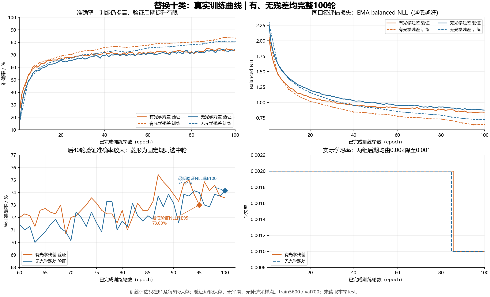
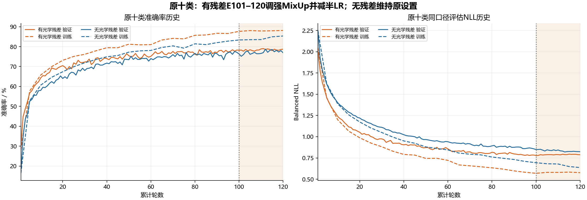

# 换类配对真实曲线、诊断与恢复原十类的下一步

本报告仅读取已完成本轮164独占科学及旧169/165保存的聚合history，历史SHA与fit_result匹配；不构造模型、不读取test图片或重新审核。原始机器JSON留在private，epoch_metrics.csv只含逐轮聚合评估数值与来源SHA。两张PNG和SVG已真实生成，全部2张PNG实际view_image检查了中文、坐标、图例、采样点与选中标记；没有PDF或旧图作者/markers重跑。

橙色有光学残差、蓝色无光学残差，虚线训练EMA评估、实线验证EMA评估；训练只在E1/每5轮保存，验证每轮保存，没有补造采样或平滑。损失图为同口径balancedNLL，不把含MixUp/相位TV/capture辅助项的训练objective与纯验证NLL混比。右下为实际LR，后期约E86-87由.002降.001。两组都完整100轮，菱形只是固定firstmin验证NLL选中权重E95/E100，不是提前停止。

## 不是简单二选一：仍有缓慢收敛，也有泛化差距

- 残差E80到E100训练80.29%到83.38%，验证72.57%到73.57%，验证NLL .88609到.84139：仍在改善，不能断言完全收敛；但训练涨得更快、准确率后段起伏大，显示泛化差距。
- 无残差同期训练78.14%到80.88%，验证71.71%到74.14%，NLL .92461到.87552：同样未完全平稳，验证准确率追上了残差。没有看到验证损失长期持续反弹的纯粹过拟合形状，不能把低分全归为过拟合。
- 按既定选中权重，残差train83.89/val73.00、gap10.89pp，无残差80.88/74.14、gap6.73pp；残差泛化差距更明显。但铁路站残差训练本身仅60.54%、验证45.71%，亦有拟合困难；梯田80.18/61.43则泛化差距较大。

## 为什么换类反而下降

按各自既定选中模型，残差旧十类78.14%到新十类73.00%下降5.14pp，其中换掉桥梁/网球场与换入铁路站/梯田的两类贡献约-2.29pp，其余8类合计又贡献-2.86pp。这是对保存指标的算术分解，不是独立因果证明：类别上下文一变，优化和混淆边界也变了，不能只看原20验证排名就保证新子任务更好。

新残差验证CM中，火电站有11/70错成铁路站，铁路站有11/70错成交叉路口、10/70错成梯田、9/70错成火电站。原来保留的交叉路口/火电站等也被影响，不能理解为仅替换两行指标、其他8行固定。旧20有残差114轮、无残差58轮均因time_budget退出，也不能用不等轮选中大差距证明新类稳定优势。

## 恢复原十类：先做一次保持原设置的有界接续

用户明确要求换回原十类继续优化，恢复bridge/desert/harbor/intersection/island/lake/meadow/tennis_court/thermal_power_station/wetland，不再换名单。

旧残差E100验证78.1429%、NLL.778557，E101-120上次同时MixUp.2改.4并将恢复LR额外减半，后20轮最低NLL.779744，未改善该选模指标。因此这次不重复它，恢复E100完整raw/EMA/Adam35000/scheduler100、LR.0005，保持MixUp.2和既有scheduler，不额外减半LR，继续一次E101-140、最多1800新增fit秒，无early/自动retry。只GPU2一子。选模仍firstminimum验证EMA balancedNLL，包括保留100轮；新阶段如果没有更好点，仍保留原E100。

这检验的是原训练配置继续收敛能否带来提升，不能保证40轮到80。原无残差E100验证76.2857%或原120轮选E11377.1429%只是明确标注的历史参考；新残差多40轮，差距不能冒称新增同预算光学残差因果优势。先提高残差自身成绩，不刻意削弱无残差；最终若需要证明更强消融优势，应另固定匹配优化设置/预算对照。本次不自动追加对照、test、电子后备或更多候选。

新173源runner/profile/protocol/audit在旧169之外，旧164/160/165/167/169/171和所有数据/PT/失败/claims/图markers保持。完整合同见[恢复原十类一致接续协议](../../../RESISC10_RESTORE_STEADY40_PROTOCOL_20261015.md)。
